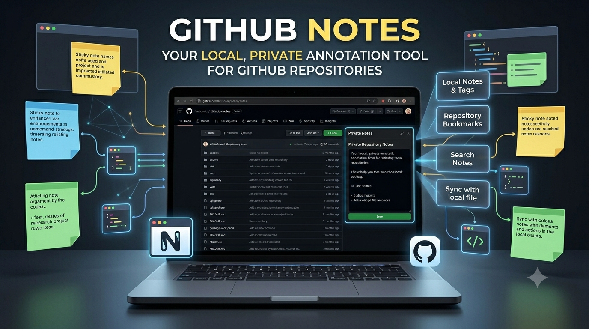

# GitHub Notes

<div align="center">


**Add private notes to GitHub repositories and review them where you actually work**

[](LICENSE)
[](https://chromewebstore.google.com/detail/github-notes/mejhlipglijbkcfcnljjdcdngafbbheo)
[](https://microsoftedge.microsoft.com/addons/detail/github-notes/kjecncpipakdbomdpagliljcaomojjbk)
[](https://github.com/zjkal/github-notes/releases)

English | [中文](README.md)

</div>

---

## Quick Start

### Install from a store (recommended)

> For most users, install from an official store to get automatic updates—no developer mode required.

| Browser | Install |
|---------|---------|
| **Chrome** | [Chrome Web Store](https://chromewebstore.google.com/detail/github-notes/mejhlipglijbkcfcnljjdcdngafbbheo) |
| **Edge** | [Microsoft Edge Add-ons](https://microsoftedge.microsoft.com/addons/detail/github-notes/kjecncpipakdbomdpagliljcaomojjbk) |

After installation, open any GitHub repository and find the note card near the sidebar About area; use the toolbar icon to search and manage all notes. See [Usage](#usage) below for step-by-step guides.

---

## Overview



`GitHub Notes` is a Manifest V3 extension for Chromium browsers. It keeps **private, local-only** notes for GitHub repositories—no cloud backend.

Three main workflows:

| Workflow | What you get |
|----------|----------------|
| Repository pages | Add, edit, and delete notes in the sidebar |
| Stars pages | Surface saved notes while browsing stars |
| Popup / side panel | Search, open repos, and back up all notes |

---

## Features

### Inline notes on repository pages

- Injects a note card on GitHub repository pages
- Opens an editor from the card or edit button
- Save, delete, and show last updated time
- Handles GitHub PJAX and dynamic navigation

### Notes on Stars pages

- Shows saved notes on `/<username>?tab=stars`
- Supports custom lists at `/stars/<username>/lists/<list>`
- Injects content only for repositories that already have local notes
- Click a note on the Stars page to edit it

### Popup and side panel

- Lists all notes, sorted by most recently updated
- Search by repository name or note content
- Open the related repository from a list item
- Side panel mode where `sidePanel` is supported

### Data management and extras

- Export notes and settings as JSON; import from backup files
- Options page: note count, latest update, last backup, last import
- English and Chinese UI; light and dark themes
- Default local settings on first install

### Supported GitHub URLs

- Repositories: `https://github.com/<owner>/<repo>` and sub-pages (`issues`, `pulls`, `actions`, …)
- Stars: `https://github.com/<user>?tab=stars`
- Custom Stars lists: `https://github.com/stars/<user>/lists/<list>`

---

## Usage

### Add notes on a repository page

1. Open any GitHub repository
2. Find the note card near the sidebar / About area
3. Click the card or edit button, enter text, and save

### Review notes on a Stars page

1. Open your Stars page or a Stars list
2. Repositories with saved notes show a note block
3. Click the block to edit

### Manage notes from the popup

1. Click the extension icon in the toolbar
2. Browse and search all notes in the list tab
3. Export or import JSON from the backup tab
4. Adjust preferences and view overview data in Settings or the options page

---

## Privacy and storage

- Notes live in `chrome.storage.local`; nothing is uploaded automatically
- Permissions: `storage`, `activeTab`, `sidePanel`, `https://github.com/*`
- Keys use the full repository name, e.g. `owner/repo`

---

## For developers

For contributing, debugging, or packaging your own build.

### Load unpacked (developer mode)

1. Clone the repo:

```bash
git clone https://github.com/zjkal/github-notes.git
cd github-notes
```

2. Open the extensions page: Chrome `chrome://extensions/` · Edge `edge://extensions/`
3. Enable **Developer mode**
4. **Load unpacked** and select the project root

After editing files under `src`, `pages`, `styles`, or `_locales`, click **Reload** on the extension card and refresh the GitHub tab.

### Project layout

```text
github-notes/
├── manifest.json
├── src/
│   ├── background.js
│   ├── content.js
│   ├── i18n.js
│   ├── options.js
│   └── popup.js
├── pages/
│   ├── options.html
│   └── popup.html
├── styles/
│   └── content.css
├── _locales/
│   ├── en/messages.json
│   └── zh_CN/messages.json
├── assets/
└── build.ps1
```

### Build a release zip

```powershell
.\build.ps1
```

Recreates `release/`, copies required files, and outputs `github-notes-v<version>.zip`.

### Technical notes

Manifest V3 · vanilla JavaScript · Chrome Extension / Storage / i18n APIs · `MutationObserver` with debouncing for GitHub’s dynamic DOM

---

## Contributing

Issues and pull requests are welcome. Please read [CONTRIBUTING.md](CONTRIBUTING.md) first.

## License

Released under the [MIT License](LICENSE).
